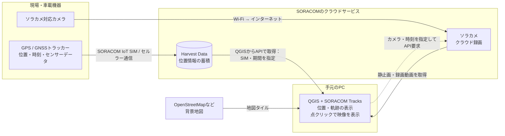
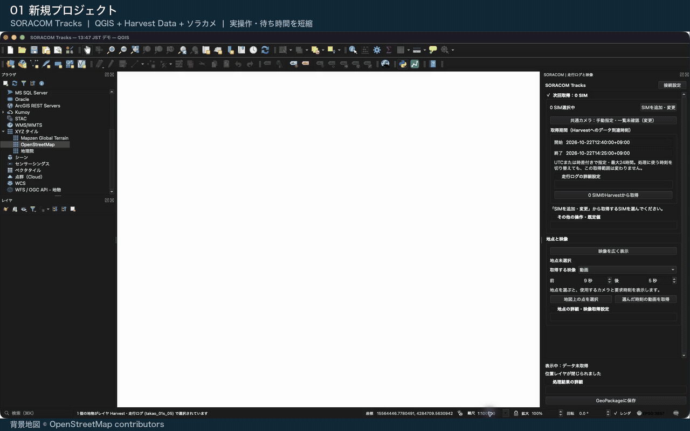

# SORACOM Tracks

SORACOM Harvest Dataに保存した位置情報をQGISに読み込み、地図上の点からソラカメの静止画・録画動画を表示するプラグインです。複数のトラッカーを重ねて表示し、SIMごとにデータ形式、処理に使う時刻、カメラを設定できます。

**非公式のプレビュー版です。** SORACOM公式製品ではありません。GitHub ReleasesのZIPからインストールできます。QGIS公式プラグインリポジトリには未登録です。

## システム構成

トラッカーの位置情報をHarvest Dataに、ソラカメの映像をソラカメのクラウドに保存しておく構成です。PCのQGISからそれぞれのAPIで取得し、地点と映像を時刻で対応づけます。ソラカメ連携は任意で、位置情報だけでも利用できます。



- **トラッカー**：自作のQLM／CLASトラッカー、GPSマルチユニット、ビーコン対応GPSトラッカーGWなどを想定しています。送信設定とHarvest Dataの有効化は事前に行い、緯度・経度を含むデータを蓄積します。プラグインは保存済みデータを読み込みます。
- **ソラカメ**：対応カメラ、インターネット接続、対象期間を録画できるライセンスが必要です。車載ではWi-Fiルーターなどで接続します。映像はソラカメ側に保存され、Harvest Dataには保存しません。
- **QGIS**：インターネット接続とSORACOMへの認証情報を使い、Harvest Dataの読み取りとソラカメのエクスポートを行います。SIMごとにカメラを割り当てるか、共通カメラを指定できます。
- **時刻での対応づけ**：測位時刻またはHarvestへのデータ到達時刻を選び、必要に応じてカメラの時刻補正を加えて映像を要求します。自動的に厳密な時刻同期を行う仕組みではありません。

サービスの設定は [Harvest Dataのドキュメント](https://users.soracom.io/ja-jp/docs/harvest/visualize/) と [ソラカメのドキュメント](https://users.soracom.io/ja-jp/docs/soracom-cloud-camera-services/) を参照してください。

## デモ

新規プロジェクトにOpenStreetMapを追加し、SIMを選んでHarvestのデータを取り込み、地図を拡大して点をクリックするとソラカメの録画動画が再生されるまでのデモです。



約39秒・音声なし。2026年10月22日13:47 JST付近の実データを使用しています。操作間の待ち時間は短縮し、動画再生には取得済みのキャッシュを使用しています。

## インストール

1. [Releases](https://github.com/takao2704/qgis-soracom-tracks/releases)から `soracom_tracks-0.9.3.zip` をダウンロードします。GitHubが自動生成する「Source code」のZIPではありません。
2. QGISの「プラグイン」→「プラグインの管理とインストール」→「ZIPからインストール」でZIPを選びます。
3. SORACOM Tracksを有効にし、「プラグイン」→「SORACOM Tracks」→「Harvestとソラカメ」を開きます。

更新時はQGISプロジェクトを保存してからZIPをインストールし、QGISを再起動してください。設定とキャッシュはプラグイン本体とは別のQGISプロファイル内に保存されます。

## 対応環境

- QGIS 3.34〜3.99。実機で確認した環境はmacOS / QGIS 3.44.8です。
- Windows 11 / QGIS 3.44.15でもローカル修正版の点クリック・動画再生・一時停止・シークを確認しています。QGIS 4、Linuxの実機操作は未検証です。
- 追加のpipパッケージは不要です。CLI認証を選ぶ場合のみ、設定済みの[SORACOM CLI](https://github.com/soracom/soracom-cli)が必要です。
- Harvestに位置情報が保存されているSIMと、読み取り権限を用意してください。トラッカーからの送信機能は含みません。
- ソラカメ連携は任意です。利用する場合は対象期間のクラウド録画とエクスポート権限が必要です。

## はじめに

1. **接続設定**から認証方法を選びます。設定済みCLI、既存SAMでの一時ログイン、専用SAM・認証キーの作成、API認証情報の入力に対応します。
2. **SIMを追加・変更**から一覧を取得し、名前やIDで絞り込んでSIMを選びます。日本・グローバル両カバレッジを取得します。
3. 各SIMの**設定**で形式と時刻基準を選びます。形式が不明な場合はサンプルを確認し、カスタム形式で項目を指定します。
4. 取得期間を指定して**Harvestから取得**します。位置点、受信機別の軌跡、全受信記録が追加されます。
5. **共通カメラ**を選ぶか、SIMの設定から個別のカメラを割り当てます。「連携しない」も選べます。
6. **地図上の点を選択**を押してから点をクリックすると、その時刻の映像を取得します。静止画または前後の秒数を指定した動画を選べます。
7. **GeoPackageに保存**した後、QGISプロジェクトも保存します。

「次回取得」には次に取得する条件、「表示中」には現在の地図に使ったSIMと期間を表示します。「映像を広く表示」で取得条件を折りたためます。

APIを呼ばずに試す場合は「その他の操作・既定値」→「サンプルを表示」を使ってください。架空の位置情報を表示します。

## データ形式と時刻

| 形式 | 対象 | 通常の時刻基準 |
| --- | --- | --- |
| QLM・CLAS共通形式 | `lat` / `lon` / `measured_at` を持つJSON、または対応するQLM NMEA形式 | デバイスの測位時刻 |
| GPSマルチユニット | Harvest内のJSON変換済みデータ | Harvestへのデータ到達時刻 |
| ビーコン対応GPSトラッカーGW | バイナリパーサーで変換済みのJSON。位置通知のみ地図化 | Harvestへのデータ到達時刻 |
| カスタム形式 | 緯度・経度・時刻・追加の値のパスを指定するJSON | SIMごとに選択 |

取得期間は常に**Harvestへのデータ到達時刻**で指定します。軌跡の並び順、欠測区間の分割、映像の要求時刻に使う時刻は、SIMごとに**測位時刻／データ到達時刻**から選べます。両方の元時刻を属性に残します。

形式・時刻を変更すると、取得済みのデータに約0.5秒後に自動反映します。再取得のAPI呼び出しは行いません。反映に失敗した場合は元の地図を保持し、修正すべき設定への案内を表示します。

カスタム形式ではHarvestの `content` 内を起点に `location.latitude` や `values[0].value` のようなパスを指定します。温度に限らず、数値・文字列・真偽値の属性を最大50項目追加できます。プレビューで変換結果を確認してから保存してください。

形式の例と制限は [データ形式](docs/DATA_FORMATS.md) を参照してください。

## ソラカメ連携

- SIMごとに共通カメラ、個別カメラ、連携しない、を選べます。名前・IDで一覧を絞り込めます。
- 点クリックによる取得は初期状態で有効です。保存済みの映像があればキャッシュを使います。
- 静止画1枚は1秒分、動画は要求した秒数分のエクスポート枠を使用します。動画は合計1〜900秒です。
- 起動時やプロジェクトの再読込、地点選択の復元では新規のエクスポートを行いません。
- オフラインのカメラも選べますが、対象時刻の録画が必要です。
- 時刻補正を指定できます。要求時刻と実フレーム時刻の一致や同期精度を保証するものではありません。
- 動画はQt Multimediaで再生します。WindowsでQtの動画デコーダーが失敗した場合は、VLC 3があれば同じQGISパネル内で再生を続けます。QGISと同じビット数のVLC 3を公式サイトから導入してください。通常のインストール先を自動検出します。ZIP版は `libvlc.dll` と `plugins/` があるフォルダーを、QGISプロファイルの設定 `soracom_tracks/vlc_directory` または起動時のプロセス環境変数 `SORACOM_TRACKS_VLC_DIR` に指定します。環境変数を優先し、PC全体の設定は変更しません。VLC本体はプラグインZIPに含めません。
- 再生ボタンで再生・一時停止を切り替え、シークバーのドラッグや矢印キーで位置を変更できます。保存済み動画の参照は未ログインでも利用でき、新規API取得にはログインが必要です。

## 認証と保存先

CLI方式では既存のプロファイルを使います。「API認証情報を入力」と「専用SAM・認証キーを作成して継続利用」の秘密情報は、QGISの暗号化認証ストアに保存します。APIキーだけでは認証できません。継続利用する認証キーID／シークレット、または期限付きAPIキー／APIトークンの組を入力してください。

「既存SAMでログイン」は、そのSAMの権限でAPIへ直接アクセスします。パスワードと期限付きトークンは保存せず、QGIS終了時または接続設定の「ログアウト」でセッションを破棄します。次回起動時や有効期限切れの際は再ログインします。

「専用SAM・認証キーを作成して継続利用」は、SAM／ルートでログインし、専用SAMユーザーと認証キーを新規作成します。読み取りとソラカメのエクスポートに必要なAPI権限を設定しますが、対象を特定SIM・カメラに限定するリソース制限は設けません。詳細と作成中断時の対処は [認証と権限](docs/AUTHENTICATION.md) に記載しています。

設定はQGISプロファイルの `soracom_tracks/`、画像・動画はその中の `cache/` に保存します。GeoPackageには位置、軌跡、受信記録、メディアの参照情報を保存します。**画像・動画ファイルはGeoPackageに埋め込みません。** 別PCへ移す場合はキャッシュの移動と参照パスの調整が必要です。

## 制限・トラブルシューティング

- 1回の取得は最大20 SIM・24時間です。内部では1時間ごとに分割します。1 SIMあたり10万受信記録、全SIM合計10万測位点までです。
- 全SIMの取得が完了してから地図を更新します。途中の失敗・中止時には元のレイヤを保持します。
- 測位時刻を選んだのに時刻が欠落している場合、到達時刻で自動代用しません。有効な座標は点として残しますが、その点の軌跡・映像要求は行いません。
- 位置がずれる場合はSIMの形式設定の緯度・経度パス、単位、ログのCRSを確認してください。緯度・経度の度数値は通常 `EPSG:4326` です。
- FIX等の表示はログの測位状態を表します。絶対精度を保証しません。
- 映像の取得失敗時は、カメラ、録画期間、時刻基準、補正秒、権限を確認してください。処理結果の詳細を開いて確認・コピーできます。
- 中止しても、サーバーが受理済みのエクスポートは取り消せません。結果不明の作成要求を自動で繰り返しません。

問題の報告は [Issues](https://github.com/takao2704/qgis-soracom-tracks/issues) へお願いします。OS、QGIS・プラグインのバージョン、再現手順を添え、認証情報、実SIM ID、カメラID、位置情報、画像の共有は避けてください。

## 開発・検証

```sh
# QGISに依存しないテスト。QGISがない場合、GUI統合テストはスキップされます。
python3 -m unittest discover -s tests -v

# QGISのPython環境で全テスト（macOSの例）
QT_QPA_PLATFORM=offscreen PYTHONPATH=. /Applications/QGIS.app/Contents/MacOS/python -m unittest discover -s tests -v

# インストール用ZIPを作成
python3 build.py --output dist/soracom_tracks-0.9.3.zip
```

配布ZIPはファイルの許可リストから構築します。実データ、認証情報、設定、キャッシュ、作業記録は含めません。検証範囲は [v0.9.3の検証](docs/RELEASE_VALIDATION.md)、変更履歴は [CHANGELOG](CHANGELOG.md) を参照してください。

## ライセンス

GNU General Public License version 2 or later（GPL-2.0-or-later）。詳細は [LICENSE](LICENSE) を参照してください。QGISおよびSORACOMの名称は各権利者に帰属します。
